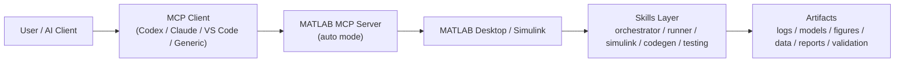
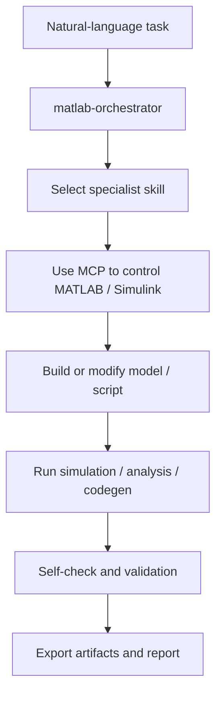

<div align="center">

# ⚙️ MATLAB Agent Skills

**Turn MATLAB into an agent-ready engineering workbench**

*9 skills · MCP-first · Reproducible by default · Validated on MATLAB R2026a*

[](https://github.com/wzyn20051216/matlab-agent-skills/actions/workflows/repository-checks.yml)
[](https://github.com/wzyn20051216/matlab-agent-skills/actions/workflows/matlab-validation.yml)
[](LICENSE)
[](docs/SUPPORT_MATRIX_ZH.md)
[](docs/WINDOWS_BETA_ZH.md)

[✨ Features](#-features) · [📦 Install](#-installation) · [🚀 Quick Start](#-quick-start) · [🧩 Skills](#-skill-suite) · [⚡ Demo](#-power-electronics-demo-48-v--12-v-buck) · [📖 Docs](#-documentation)

</div>

---

## Why This Exists

Modern MATLAB ships with a deep engineering stack — Simulink, MATLAB Coder, Embedded Coder, ROS, Control System, Optimization, Deep Learning, Signal Processing, Computer Vision and more. But coding agents usually only *write plausible* `.m` snippets: nothing is executed, nothing is measured, nothing is reproducible.

`matlab-agent-skills` closes that gap with one hard rule:

> **Every task must end with a runnable command, captured logs, saved artifacts, and an acceptance check.**

Built for developers, researchers, and model-based engineering teams who want agents to do *real* MATLAB work.

> [!IMPORTANT]
> This repository is open source, but it is **not a MATLAB licence**. The full workflow requires your own licensed MATLAB R2026a installation plus the relevant toolboxes. Without a valid licence, MCP control, Simulink, codegen and HIL flows are only partially available.

## ✨ Features

| | |
|---|---|
| 🔌 **MCP-first** | Official MATLAB MCP server as the default execution path — real MATLAB, not prompt-only codegen |
| 🧭 **Task routing** | `matlab-orchestrator` routes fuzzy requests to 8 specialist skills |
| 📊 **Simulink automation** | Model creation, topology edits, simulation and signal checks — programmatically |
| 📁 **Artifacts by default** | Logs, figures, data, reports, validation JSON on every run |
| 🖥️ **One-command install** | Codex, Claude Code, VS Code and generic MCP clients |
| 🔁 **Reproducible** | Pinned server binary (SHA-256), manifest-driven installs, bit-identical re-runs |

## 📦 Installation

**Prerequisites:** Windows 10/11 · PowerShell 5.1 or 7 · MATLAB R2026a installed and activated **for the same Windows user** running the scripts · network on first run (the pinned MCP server binary is downloaded and SHA-256 verified).

> [!NOTE]
> MATLAB online-licence activation is stored per Windows user profile. A brand-new Windows user must activate MATLAB first, otherwise batch launches fail with LME 5201 — see [Troubleshooting](docs/TROUBLESHOOTING_ZH.md).

### Default (recommended)

```powershell
git clone https://github.com/wzyn20051216/matlab-agent-skills.git
cd matlab-agent-skills
powershell -ExecutionPolicy Bypass -File .\scripts\Sync-Skills.ps1
```

Installs 9 skills to the current user's `.agents/skills`, shared by Windows CLI and Desktop clients. Discovery, content loading and MCP execution are each independently accepted — see the [installation guide](docs/SKILL_INSTALLATION_ZH.md).

### Pinned (reproducible)

Tag [`v0.6.0-preview.2`](../../releases) pins the end-to-end validated technical preview (2026-10-21). `main` has since moved ahead with later phases and audit fixes; the tag stays where validation happened. Compare before installing:

```powershell
git clone --branch v0.6.0-preview.2 --depth 1 https://github.com/wzyn20051216/matlab-agent-skills.git
git rev-parse HEAD; git rev-parse 'v0.6.0-preview.2^{commit}'   # must match
```

> [!WARNING]
> There is intentionally **no `irm | iex` one-liner**: that pattern executes whatever the branch contains at that moment and cannot be reviewed. Clone and run from the checked-out tree instead. (The MCP server binary itself *is* pinned and hash-verified — see [WINDOWS_BETA_ZH](docs/WINDOWS_BETA_ZH.md) §4.1.)

## 🚀 Quick Start

### 1 · Wire up MATLAB MCP

```powershell
# auto-mode setup (discovers MATLAB and the server binary)
powershell -ExecutionPolicy Bypass -File .\scripts\Setup-MatlabMcpExistingSession.ps1 -McpServerName matlab-official

# verify readiness
powershell -ExecutionPolicy Bypass -File .\scripts\Test-MatlabMcpExistingSession.ps1
```

<details>
<summary><b>If <code>tools/call</code> hangs while <code>initialize</code> succeeds → use a held shared session</b></summary>

On Windows + R2026a (2026-10-28) the `auto`/`new` cold-launch paths can hang; the **existing-session** path is verified end-to-end:

```powershell
# 1) hold a shared MATLAB session (idle timer, does not block the main thread)
powershell -ExecutionPolicy Bypass -File .\scripts\Start-MatlabSharedSession.ps1 -HoldMinutes 25

# 2) verify in existing mode
powershell -ExecutionPolicy Bypass -File .\scripts\Test-MatlabMcpExistingSession.ps1 `
  -Backend matlab-mcp-existing -Transport stdio -ProjectRoot . -Json
```

Measured: **7/7 checks PASS, level L4**, `evaluate_matlab_code` returns the real version string in ~1.9 s. To pin clients to this mode permanently, register them with **SessionMode existing** (see `Install-MatlabMcpClients.ps1`). Constraints (don't start another MATLAB while held; release via the **stop_session.flag** file) in [TROUBLESHOOTING_ZH](docs/TROUBLESHOOTING_ZH.md).

</details>

### 2 · Register MCP clients

```powershell
powershell -ExecutionPolicy Bypass -File .\scripts\Install-MatlabMcpClients.ps1 -Clients codex,claude   # one command
powershell -ExecutionPolicy Bypass -File .\scripts\Install-MatlabMcpClients.ps1 -Clients auto           # auto-detect + generic .mcp.json
powershell -ExecutionPolicy Bypass -File .\scripts\Install-MatlabMcpClients.ps1 -Clients vscode -ProjectPath .
```

### 3 · Run one real task — not a toy prompt

```text
单位负反馈系统，开环传递函数 L(s)=10/((s+1)(s+2))。
请报告 0 dB 交越处的相位裕度、增益裕度、闭环是否稳定以及闭环极点，
并用官方 MATLAB MCP 在真实 MATLAB 里算，不要手算。
```

**Expected:** `matlab-control-optimization` + `matlab-runner` fire through the official MCP, and the numbers come back as **PM ≈ 55.862240°, GM = Inf, closed-loop stable, poles −1.5 ± 3.1224989992j**.

### 4 · Local validation

```powershell
powershell -ExecutionPolicy Bypass -File .\scripts\Test-MatlabSkills.ps1                                    # smoke test
powershell -ExecutionPolicy Bypass -File .\scripts\Invoke-MatlabBatch.ps1 -Script .\path\to\script.m        # custom script w/ logs
$matlabExe = (Get-Command matlab).Source
powershell -ExecutionPolicy Bypass -File .\scripts\Test-MatlabEmbeddedStack.ps1 -MatlabPath $matlabExe      # full embedded chain
```

## 🧩 Skill Suite

| Skill | Purpose |
|---|---|
| [`matlab-orchestrator`](skills/matlab-orchestrator) | 🧭 Entry point — routes any MATLAB-flavoured request |
| [`matlab-runner`](skills/matlab-runner) | ▶️ Batch execution, logs, toolbox inventory, smoke tests |
| [`matlab-data-analysis`](skills/matlab-data-analysis) | 📈 Tables, statistics, fitting, visualization, paper figures |
| [`matlab-simulink-modeling`](skills/matlab-simulink-modeling) | 🔧 `.slx` creation, topology edits, simulation, signal checks |
| [`matlab-codegen-deploy`](skills/matlab-codegen-deploy) | ⚙️ MEX, C/C++, embedded, GPU, HDL-oriented codegen |
| [`matlab-control-optimization`](skills/matlab-control-optimization) | 🎛️ Control design, identification, MPC, constrained optimization |
| [`matlab-robotics-autonomy`](skills/matlab-robotics-autonomy) | 🤖 ROS, navigation, UAV, sensor fusion |
| [`matlab-signal-vision-ai`](skills/matlab-signal-vision-ai) | 👁️ Signal, image, lidar, medical imaging, deep learning |
| [`matlab-testing-ci`](skills/matlab-testing-ci) | ✅ `matlab.unittest`, Simulink Test, GitHub Actions, acceptance reports |

## 🏗️ Architecture





## ⚡ Power-Electronics Demo: 48 V → 12 V Buck

A closed-loop **48 V → 12 V, 50 kHz Buck converter** (L = 150 µH, C = 220 µF, R = 6 Ω) — the repository's flagship *engineering* example: cascaded dual loop (outer PI voltage → inductor-current command → proportional inner current → duty), load-current feedforward, boundary sampling with analytic half-ripple compensation, and one switching period of computation delay.

This is a **simulation** demo, validated up to switching-level simulation with a non-ideal sensor chain. No hardware measurement, no device-level model, no DCM region — see [Limitations](#-limitations-of-this-demo).

### Run it

```bash
# 40 s, base MATLAB only: reproduces the published numbers, exits nonzero on failure
matlab -batch "run('matlab/buck/verify/buck_smoke.m')"

# full acceptance matrix (C1-C7 x baseline + stress configs, ~10 min)
export BUCK_OUT="$PWD/artifacts/validation/buck"
matlab -batch "run('matlab/buck/verify/buck_a6_task6_accept.m')"
```

`BUCK_OUT` is the only knob: every script writes its JSON/MAT/PNG there and reads nothing it did not produce itself — a run in an empty directory is self-contained.

<details>
<summary><b>Toolbox requirements (source of truth: <code>requiredFilesAndProducts</code>, not guesses)</b></summary>

| Entry point | Products |
|---|---|
| `verify/buck_smoke.m` | MATLAB |
| `verify/buck_a6_task4_phase.m` | MATLAB |
| `verify/buck_a6_task5_margin.m` | MATLAB |
| `verify/buck_a6_task6_accept.m` | MATLAB |
| `verify/buck_a6_task1_stability.m` | MATLAB, Control System Toolbox |
| `build_buck_switching.m` (reference model) | MATLAB, Simulink |

The switching-level acceptance path runs on **base MATLAB**. Control System Toolbox is needed only for average-model design scripts; Simulink only for the reference switching model the fast engine is cross-checked against.

</details>

### Acceptance criteria (unchanged since Phase 3A.1)

| ID | Criterion | Threshold |
|---|---|---|
| S1 | Stability | local asymptotic stability of the periodic orbit (Floquet multipliers < 1) |
| S2 | Phase margin | ≥ 50° |
| S3 | Gain margin | ≥ 6 dB |
| S4 | Steady-state error | ≤ 0.1 % |
| S5 | Settling | within ±1 %, continuously, ≤ 1 ms |
| S6 | Start-up overshoot | ≤ 5 % |
| S7 | Load-step dip | ≤ 12 % |
| S8 | Duty cycle | 0.05 … 0.85 |
| S9 | Reproducibility | same seed, bit-identical results |

Verification levels: **A** average · **B** discrete average · **C** discrete + sensor non-idealities · **D** switching (PWM, ripple, conduction losses) · **D+** switching + sensor chain · **E** hardware *(not performed)*. Per-level results: [PHASE3A6_JOINT_AND_FREEZE_ZH](docs/PHASE3A6_JOINT_AND_FREEZE_ZH.md) · [PHASE3A6B_TASKS4_7_ZH](docs/PHASE3A6B_TASKS4_7_ZH.md).

### ⚠️ Limitations of this demo

Read these before quoting any number:

- **S2 / S3 are average-model design values, not switching-level measurements.** PM/GM are small-signal LTI quantities; the switching converter is periodic and has no single linear loop to break. Switching-dynamics substitutes: delay margin (1 period), controller-gain margin (×1.253) — *weaker* claims than PM/GM.
- **CCM only.** Operation below the CCM boundary (R greater than about 20 Ω at 150 µH) is **not modelled**; results there are undefined, not "good".
- **Conduction parameters are placeholders**: switch on-resistance 1 mΩ, diode on-resistance 2 mΩ, diode forward drop 0.35 V. The tolerance study includes a realistic 50 mΩ switch as a sensitivity case.
- **The current clamp bounds the cycle average** at Imax = 12 A; the instantaneous peak reaches about 12.04 A (Imax plus half the inductor ripple). Real protection must act on instantaneous current.
- **No hardware.** Level E is absent — nothing here is a statement about a physical board.

## 🧪 Validation Status

Verified on the reference machine (Windows 11 + R2026a, 2026-10-28; details in [WINDOWS_BETA_ZH](docs/WINDOWS_BETA_ZH.md)):

| Item | Status |
|---|---|
| Offline free test layer, PowerShell 5.1 **and** 7 | ✅ **413/413** (incl. path-hygiene gate, now green) |
| Default install (`%USERPROFILE%\.agents\skills`) | ✅ 9 skills; upgrade / idempotent re-sync / rollback / scoped uninstall |
| Codex CLI 0.147.0 & Desktop 0.163.0-alpha discovery | ✅ 9/9 skills, `discoveryErrors=[]` |
| MATLAB MCP existing-session acceptance | ✅ 7/7 PASS, level **L4** |
| MCP cold-launch (`auto` / `new` modes) | ⚠️ can hang on R2026a — use held shared session (see [Quick Start](#-quick-start)) |

## 📚 Documentation

| Document | Content |
|---|---|
| [SKILLS_INTRO_ZH](docs/SKILLS_INTRO_ZH.md) | 中文项目介绍 |
| [SKILL_INSTALLATION_ZH](docs/SKILL_INSTALLATION_ZH.md) | CLI / Desktop 共享安装与卸载 |
| [MCP_EXISTING_SESSION_ZH](docs/MCP_EXISTING_SESSION_ZH.md) | 官方 MATLAB MCP 指南 |
| [MATLAB_DESKTOP_STARTUP_ZH](docs/MATLAB_DESKTOP_STARTUP_ZH.md) | 可见桌面会话启动说明 |
| [WINDOWS_BETA_ZH](docs/WINDOWS_BETA_ZH.md) | Windows 测试版说明、验证边界与卸载回滚 |
| [SUPPORT_MATRIX_ZH](docs/SUPPORT_MATRIX_ZH.md) | 支持环境矩阵（哪些实测、哪些没测） |
| [TROUBLESHOOTING_ZH](docs/TROUBLESHOOTING_ZH.md) | 故障排查 |
| [CHANGELOG](CHANGELOG.md) | 变更记录 |

## 📁 Repository Layout

```text
skills/                 # Codex skill definitions (9 skills)
scripts/                # PowerShell automation wrappers
matlab/                 # MATLAB sources: buck demo, validation, templates
docs/                   # Architecture, validation, release notes (ZH)
evals/                  # Skill evaluation prompts
.github/workflows/      # GitHub Actions validation example
artifacts/              # Local validation evidence (git-ignored, reproducible)
```

> **Evidence policy.** `artifacts/` holds local validation evidence — console logs, protocol captures, per-phase reports. It is **not distributed with this repository**: those files contain machine-specific paths, so the directory is git-ignored and phase documents refer to them as local artefacts. Reproduce them by running the corresponding phase driver.

## 🧪 What Validation Checks

The smoke test verifies, on the real MATLAB:

- ✅ Terminal launch of MATLAB R2026a · toolbox inventory exported to JSON
- ✅ Feature probe distinguishes direct-import support, hardware blocksets, local agent skill availability
- ✅ Deterministic numeric fitting task passes tolerance checks
- ✅ MATLAB Coder standalone C generation (`GenCodeOnly`) · nonempty PNG / `.mat` artifacts
- ✅ Simulink create-save-simulate + Simulink Coder generic C generation (when licensed)
- ✅ STM32 / Raspberry Pi support probed and exported
- ✅ VS Code / STM32CubeMX / Keil embedded toolchain bundle audited (`cortex-debug`, `cpptools`, `keil-assistant`, …)
- ✅ STM32 codegen readiness: registered CubeMX, target names, GNU ARM tools, CMSIS / CMSIS-DSP, firmware packages, `.ioc` binding

## 🗺️ Roadmap

- [ ] Packaged `.skill` releases
- [ ] Benchmark viewer outputs for representative MATLAB tasks
- [ ] Real paper-reproduction examples with public datasets
- [ ] Simulink model topology diff tooling
- [ ] Codegen golden-output comparison templates
- [ ] Self-hosted runner guide for licensed MATLAB/Simulink CI
- [ ] More R2026a capability probes as MathWorks docs evolve

## 🤝 Contributing

Contributions are welcome when they make MATLAB agent workflows more **executable, measurable, or reproducible**. See [CONTRIBUTING.md](CONTRIBUTING.md) and [ROADMAP.md](ROADMAP.md) · Security policy: [SECURITY.md](SECURITY.md).

For open-source paper reproduction, the expected loop is:

1. Record paper / code / dataset URLs, commit hash, MATLAB release, toolbox list
2. Run the smallest official example first
3. Reproduce one figure or table before scaling up
4. Save raw logs, processed results, figures, and `manifest.json`
5. **Report numerical deltas** instead of hand-waving visual similarity

```matlab
manifestPath = reproducible_project_template("project-name", "https://example.com/source");
```

## 📜 Design Principles

- Task-first skills, not toolbox-name wrappers
- Official MathWorks docs and local MATLAB probes beat memory
- Forum and blog knowledge is useful only after local verification
- Every generated artifact should be inspectable and reproducible
- CI should run the same commands a developer runs locally

## 🔗 Related Work

- [MATLAB Agentic Toolkit](https://github.com/matlab/matlab-agentic-toolkit)
- [Simulink Agentic Toolkit](https://github.com/matlab/simulink-agentic-toolkit)
- [MATLAB Actions](https://github.com/matlab-actions)

> This project is not an official MathWorks product. It is an independent, developer-oriented skill suite designed to make MATLAB R2026a easier for coding agents to use responsibly.

## License

[MIT](LICENSE) © Contributors
