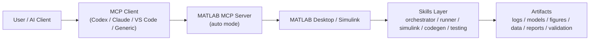
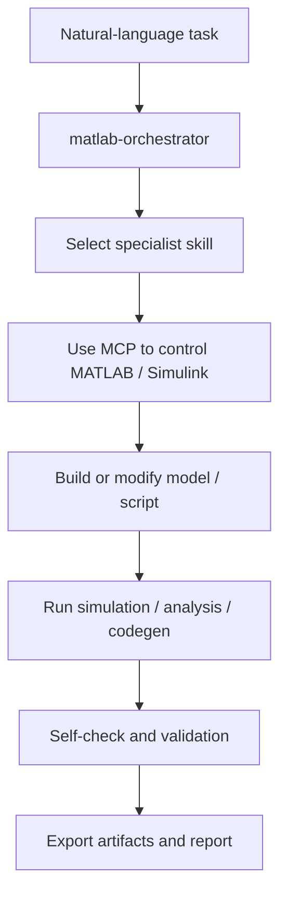

# MATLAB Agent Skills

> A production-minded Codex skills suite for MATLAB, Simulink, code generation, engineering simulation, research reproduction, and closed-loop validation.

[](https://github.com/wzyn20051216/matlab-agent-skills/actions/workflows/matlab-validation.yml)
[](https://github.com/wzyn20051216/matlab-agent-skills/actions/workflows/repository-checks.yml)
[](LICENSE)
[](https://www.mathworks.com/products/matlab.html)

`matlab-agent-skills` turns MATLAB from a tool you manually drive into an agent-ready engineering workbench. It packages MATLAB / Simulink / toolbox workflows as Codex skills with one hard rule: every task should end with a runnable command, captured logs, saved artifacts, and an acceptance check.

This project is built for developers, researchers, and model-based engineering teams who want agents to do real MATLAB work, not just write plausible `.m` snippets.

Full capability statement: this repository is open source, but its full workflow potential depends on a properly licensed MATLAB R2026a installation plus the required MathWorks toolboxes, support packages, and third-party embedded toolchains. Without a valid licensed environment, some MCP control, Simulink, code generation, and hardware-in-the-loop flows will only be partially available or unavailable.

- Chinese project introduction: `docs/SKILLS_INTRO_ZH.md`
- Short-video script (Chinese): `docs/SHORT_VIDEO_SCRIPT_ZH.md`
- Official MATLAB MCP guide: `docs/MCP_EXISTING_SESSION_ZH.md`
- CLI / Desktop 共享安装与卸载：[安装说明](docs/SKILL_INSTALLATION_ZH.md)
- 双端独立验收与可见桌面启动：[验收记录](docs/PHASE4_4_DUAL_CLIENT_ZH.md)、[启动说明](docs/MATLAB_DESKTOP_STARTUP_ZH.md)
- 安装与执行基础设施可靠性收尾（缺陷逐项结论、免费层 306/306（Phase 4.7 后）、平台范围）：[Phase 4.4.1 记录](docs/PHASE4_4_1_RELIABILITY_ZH.md)
- Windows 测试版说明、验证边界与卸载回滚：[WINDOWS_BETA_ZH](docs/WINDOWS_BETA_ZH.md)
- 故障排查：[TROUBLESHOOTING_ZH](docs/TROUBLESHOOTING_ZH.md)
- 支持环境矩阵（哪些实测、哪些没测）：[SUPPORT_MATRIX_ZH](docs/SUPPORT_MATRIX_ZH.md)
- Changelog: `CHANGELOG.md`

## Highlights

- MCP-first MATLAB / Simulink automation, not prompt-only code generation
- One-command client install for `Codex` and `Claude Code`
- Auto-mode MATLAB MCP setup that can reuse or automatically start MATLAB desktop
- Simulink modeling, tuning, validation, and codegen-oriented workflows
- Engineering artifacts by default: logs, figures, data, reports, validation JSON

## Why This Exists

Modern MATLAB ships with a deep engineering stack: Simulink, MATLAB Coder, Embedded Coder, ROS Toolbox, Control System Toolbox, Optimization Toolbox, Deep Learning Toolbox, Signal Processing Toolbox, Computer Vision Toolbox, and more. This repository is currently validated on MATLAB R2026a, while the core workflow is designed to stay compatible with recent MATLAB releases whenever APIs allow.

The repository can still be inspected, extended, and partially validated in lighter environments, but the complete intended experience requires a genuine licensed MATLAB R2026a setup.

This repository provides that workflow layer:

- Route fuzzy user requests to the right MATLAB specialist skill.
- Use official MATLAB MCP auto-mode control as the default MATLAB / Simulink execution path on this machine.
- Run MATLAB from the terminal with logs and reproducible output folders.
- Build and simulate Simulink models automatically.
- Reproduce open-source paper projects with manifests and measurable deltas.
- Generate code through MATLAB Coder / Embedded Coder style workflows.
- Close every task with tests, smoke checks, or artifact validation.

## Installation

`main` **is** the validated Windows technical preview. A default clone gives the version that was
verified end-to-end on 2026-10-21; no branch switch or extra flag.

To confirm you have the validated content, compare your commit with the preview tag
`v0.6.0-preview.2` (the tag is created on the validated commit; documentation commits after the
initial validation do not change installed content):

### Default (recommended)

```powershell
git clone https://github.com/wzyn20051216/matlab-agent-skills.git
cd matlab-agent-skills
git rev-parse HEAD                           # compare with the preview tag's commit
git rev-parse 'v0.6.0-preview.2^{commit}'    # once the tag is published; the two should match
powershell -ExecutionPolicy Bypass -File .\scripts\Sync-Skills.ps1
```

默认安装到当前操作系统用户的 `.agents/skills`，Windows CLI 与 Desktop 共用一份；
WSL 使用自己的 Linux 用户目录。实际发现、正文加载与 MCP 执行分别验收，详见
[共享安装说明](docs/SKILL_INSTALLATION_ZH.md)。

### Pinned alternative (reproducible)

If you need an immutable entry point, tag `v0.6.0-preview.1` pins the pre-merge candidate
(`100e6d4`). **Its content is identical to `main`** (same tree), so both routes install the same
nine skills; the tag is not a GitHub Release and is not moved.

```powershell
git clone --branch v0.6.0-preview.1 --depth 1 https://github.com/wzyn20051216/matlab-agent-skills.git
cd matlab-agent-skills
git rev-parse HEAD
git rev-parse 'v0.6.0-preview.1^{commit}'   # the two values must match
```

`release/windows-preview` points at the same commit as the tag.

### No `irm … | iex` one-liner

There is intentionally no one-liner that pipes a moving branch into `iex`: that pattern executes
whatever the branch contains at that moment and cannot be reviewed. Clone and run the script from
the checked-out tree instead. (The MCP server binary itself is pinned and hash-verified — see
[WINDOWS_BETA_ZH](docs/WINDOWS_BETA_ZH.md) §4.1.)

## Windows beta status (technical preview)

This repository is a **Windows technical preview**. The open-source code is not a MATLAB licence:
running these skills requires your own valid MathWorks licence and the relevant toolboxes.

Verified on the reference machine (details and evidence paths in [WINDOWS_BETA_ZH](docs/WINDOWS_BETA_ZH.md)):

- free test layer **306/306** on Windows PowerShell 5.1 and PowerShell 7;
- default install to `%USERPROFILE%\.agents\skills`: 9 skills, 62 files, tree hashes identical to `skills/`;
- upgrade, idempotent re-sync, user-file preservation, failure rollback, and scoped uninstall;
- **Codex CLI 0.147.0** and **Codex Desktop engine 0.163.0-alpha.10.2** both discover 9/9 skills with `discoveryErrors=[]`;
- MATLAB MCP cold start, session binding and reuse.

Not verified — do not assume:

- autonomous CLI/Desktop task execution in this round (the Codex backend was unreachable from this host);
- Desktop UI visibility (only engine-level discovery was proven);
- any R1/R2/R3 "skills improve the agent" claim (blocked; no agent runs, therefore no gain claim);
- `ComDesktop` launch mode (UNSUPPORTED under a Windows Job that forbids breakaway);
- WSL / Linux / macOS (path-resolution logic only, no real machine).

After installing, run one real task instead of a toy prompt:

```text
单位负反馈系统，开环传递函数 L(s)=10/((s+1)(s+2))。
请报告 0 dB 交越处的相位裕度、增益裕度、闭环是否稳定以及闭环极点，
并用官方 MATLAB MCP 在真实 MATLAB 里算，不要手算。
```

Expected: `matlab-control-optimization` + `matlab-runner` are used through the official MCP, and the
numbers come back as PM ≈ 55.862240°, GM = Inf, closed-loop stable, poles −1.5 ± 3.1224989992j.

## Clients

Supported MCP client integration paths in this repository:

| Client | Status | Setup |
| --- | --- | --- |
| `Codex` | Ready | One-command install |
| `Claude Code` | Ready | One-command install |
| `VS Code` | Ready | Writes project-local `.vscode/mcp.json` |
| `Generic MCP clients` | Ready | Writes project-local `.mcp.json` |
| `Claude Desktop` | Manual | Prefer official `.mcpb` bundle from MathWorks release |

One-command install for `Codex` + `Claude Code`:

```powershell
powershell -ExecutionPolicy Bypass -File .\scripts\Install-MatlabMcpClients.ps1 `
  -Clients codex,claude
```

Auto-detect installed clients and also write a generic `.mcp.json`:

```powershell
powershell -ExecutionPolicy Bypass -File .\scripts\Install-MatlabMcpClients.ps1 `
  -Clients auto
```

Write project-local `VS Code` MCP config:

```powershell
powershell -ExecutionPolicy Bypass -File .\scripts\Install-MatlabMcpClients.ps1 `
  -Clients vscode `
  -ProjectPath .
```

## Quick Start

Set up official MATLAB MCP auto-mode control:

```powershell
powershell -ExecutionPolicy Bypass -File .\scripts\Setup-MatlabMcpExistingSession.ps1 `
  -McpServerName matlab-official
```

If auto-discovery fails, provide only the missing path explicitly:

```powershell
powershell -ExecutionPolicy Bypass -File .\scripts\Setup-MatlabMcpExistingSession.ps1 `
  -ServerExePath "C:\path\to\matlab-mcp-server-windows-x64.exe" `
  -MatlabRoot "C:\Program Files\MATLAB\R2026a"
```

Verify MCP readiness:

```powershell
powershell -ExecutionPolicy Bypass -File .\scripts\Test-MatlabMcpExistingSession.ps1
```

Run local validation:

```powershell
powershell -ExecutionPolicy Bypass -File .\scripts\Test-MatlabSkills.ps1
```

Run the full embedded acceptance chain for MATLAB + STM32 / Raspberry Pi + CubeMX / Keil / VS Code:

```powershell
$matlabExe = (Get-Command matlab -ErrorAction SilentlyContinue).Source
powershell -ExecutionPolicy Bypass -File .\scripts\Test-MatlabEmbeddedStack.ps1 -MatlabPath $matlabExe
```

Run a custom MATLAB script with captured logs:

```powershell
powershell -ExecutionPolicy Bypass -File .\scripts\Invoke-MatlabBatch.ps1 -Script .\path\to\script.m
```

## Architecture



## Workflow



## Skill Suite

| Skill | Purpose |
| --- | --- |
| `matlab-orchestrator` | Entry point and router for MATLAB tasks. |
| `matlab-runner` | Batch execution, logs, toolbox inventory, smoke tests. |
| `matlab-data-analysis` | Tables, statistics, fitting, visualization, paper figures. |
| `matlab-simulink-modeling` | `.slx` creation, topology edits, simulation, signal checks. |
| `matlab-codegen-deploy` | MEX, C/C++, embedded, GPU, HDL-oriented code generation. |
| `matlab-control-optimization` | Control design, identification, MPC, constrained optimization. |
| `matlab-robotics-autonomy` | ROS, robotics, navigation, UAV, sensor fusion workflows. |
| `matlab-signal-vision-ai` | Signal, image, vision, lidar, medical imaging, deep learning. |
| `matlab-testing-ci` | `matlab.unittest`, Simulink Test patterns, GitHub Actions, acceptance reports. |

## What Validation Checks

The smoke test currently verifies:

- MATLAB R2026a can be launched from the terminal.
- Installed toolbox inventory can be exported to JSON.
- Feature probe can distinguish direct-import support, hardware blockset presence, and local agent skill availability.
- A deterministic numeric fitting task passes tolerance checks.
- MATLAB Coder can generate standalone C source artifacts in `GenCodeOnly` mode.
- Figure export produces a nonempty PNG artifact.
- `.mat` export produces a nonempty data artifact.
- Simulink can create, save, and simulate a minimal model when licensed.
- Simulink Coder can generate generic C code from a minimal model when licensed.
- STM32 / Raspberry Pi hardware support can be probed from MATLAB and exported to JSON.
- VS Code / STM32CubeMX / Keil can be discovered and checked as an embedded toolchain bundle.
- Key embedded extensions such as `cortex-debug`, `cpptools`, `keil-assistant`, and STM32 VS Code integration can be audited.
- STM32 code generation readiness checks MATLAB-registered CubeMX, target hardware names, GNU Tools for STM32, CMSIS, CMSIS-DSP, Cube firmware packages, and `.ioc` binding assumptions.

Artifacts are written under:

```text
artifacts/
  logs/
  validation/
```

## Power-Electronics Demo: 48 V → 12 V Buck

A closed-loop 48 V → 12 V, 50 kHz Buck converter (L = 150 µH, C = 220 µF, R = 6 Ω) used as
the repository's flagship *engineering* example: a cascaded dual loop (outer PI voltage loop →
inductor-current command → proportional inner current loop → duty), load-current feedforward,
boundary sampling with analytic half-ripple compensation, and one switching period of
computation delay.

This is a **simulation** demo. It is validated up to switching-level simulation with a
non-ideal sensor chain. There is no hardware measurement, no device-level (Simscape) model,
and no DCM operating region in the model — see [Limitations](#limitations-of-this-demo).

### Run it

```bash
# 40 s, base MATLAB only: reproduces the published numbers and exits nonzero on failure
matlab -batch "run('matlab/buck/verify/buck_smoke.m')"

# full acceptance matrix (C1-C7 x baseline + stress configs, ~10 min)
export BUCK_OUT="$PWD/artifacts/validation/buck"
matlab -batch "run('matlab/buck/verify/buck_a6_task6_accept.m')"
```

`BUCK_OUT` is the only knob: every script writes its JSON/MAT/PNG there and reads nothing
from it that it did not produce itself, so a run in an empty directory is self-contained.

### Toolbox requirements

`matlab.codetools.requiredFilesAndProducts` is the source of truth here, not a guess:

| Entry point | Products |
| --- | --- |
| `verify/buck_smoke.m` | MATLAB |
| `verify/buck_a6_task4_phase.m` | MATLAB |
| `verify/buck_a6_task5_margin.m` | MATLAB |
| `verify/buck_a6_task6_accept.m` | MATLAB |
| `verify/buck_a6_task1_stability.m` | MATLAB, Control System Toolbox |
| `build_buck_switching.m` (reference model) | MATLAB, Simulink |

The switching-level acceptance path therefore runs on **base MATLAB**. Control System Toolbox
is needed only for the average-model design scripts (PM/GM design values, discrete poles), and
Simulink only for the reference switching model that the fast engine is cross-checked against.
If a required product is missing, MATLAB fails inside the entry point; the table above tells
you which one before you start.

### Acceptance criteria (unchanged since Phase 3A.1)

| ID | Criterion | Threshold |
| --- | --- | --- |
| S1 | Stability | local asymptotic stability of the periodic orbit (Floquet multipliers < 1) |
| S2 | Phase margin | ≥ 50° |
| S3 | Gain margin | ≥ 6 dB |
| S4 | Steady-state error | ≤ 0.1 % |
| S5 | Settling | within ±1 %, continuously, ≤ 1 ms |
| S6 | Start-up overshoot | ≤ 5 % |
| S7 | Load-step dip | ≤ 12 % |
| S8 | Duty cycle | 0.05 … 0.85 |
| S9 | Reproducibility | same seed, bit-identical results |

Verification levels: **A** average model, **B** discrete average model, **C** discrete + sensor
non-idealities, **D** switching (PWM, ripple, conduction losses), **D+** switching + sensor
chain, **E** hardware *(not performed)*. Results per level and per criterion are in
[`docs/PHASE3A6_JOINT_AND_FREEZE_ZH.md`](docs/PHASE3A6_JOINT_AND_FREEZE_ZH.md) and
[`docs/PHASE3A6B_TASKS4_7_ZH.md`](docs/PHASE3A6B_TASKS4_7_ZH.md).

### Limitations of this demo

Read these before quoting any number from the demo:

- **S2 / S3 are average-model design values, not switching-level measurements.** A phase margin
  is a small-signal LTI quantity; the switching converter is periodic and has no single linear
  loop to break. Substitutes measured on the switching dynamics are the delay margin (1 period)
  and the controller-gain margin (×1.253). They are *weaker* claims than PM/GM.
- **CCM only.** The plant equations continue through zero inductor current, so operation below
  the CCM boundary (roughly R > 20 Ω at 150 µH, i.e. below ~0.6 A) is **not modelled**.
  Results in that region are undefined, not "good".
- **Conduction parameters are placeholders.** `RonSW = 1 mΩ`, `RonD = 2 mΩ`, `Vf = 0.35 V` are
  not datasheet values for a real 48 V design; the tolerance study in
  `verify/buck_a6_task5_margin.m` includes a realistic 50 mΩ switch as a sensitivity case.
- **The current clamp is on the current *command*, not the instantaneous switch current.**
  `Imax = 12 A` bounds the cycle average; the measured instantaneous peak reaches
  `Imax + ΔiL/2`, which is 12.04 A at 150 µH. A real protection must be defined on the
  instantaneous current.
- **No hardware.** Level E is absent. Nothing here is a statement about a physical board.
- **L = 220 µH is a simulation candidate, not a selection.** It improves ripple, S4 and S5 but
  worsens the load-step dip; no candidate dominates on every criterion, and none has been
  measured.

## Repository Layout

```text
skills/                 # Codex skill definitions
scripts/                # PowerShell automation wrappers
matlab/validation/      # MATLAB smoke tests and reproduction templates
docs/                   # Architecture, sources, validation, release notes
evals/                  # Skill evaluation prompts
.github/workflows/      # GitHub Actions validation example
```

## Contributing

Contributions are welcome when they make MATLAB agent workflows more executable, measurable, or reproducible. See [CONTRIBUTING.md](CONTRIBUTING.md) and [ROADMAP.md](ROADMAP.md).

Security policy: [SECURITY.md](SECURITY.md)

## Paper Reproduction Mode

For open-source papers and engineering examples, the expected loop is:

1. Record paper URL, code URL, dataset URL, commit hash, MATLAB release, and toolbox list.
2. Run the smallest official example first.
3. Reproduce one figure or table before scaling up.
4. Save raw logs, processed results, generated figures, and `manifest.json`.
5. Report numerical deltas instead of hand-waving visual similarity.

The helper template is:

```matlab
manifestPath = reproducible_project_template("project-name", "https://example.com/source");
```

## Design Principles

- Task-first skills, not toolbox-name wrappers.
- Official MathWorks docs and local MATLAB probes beat memory.
- Forum and blog knowledge is useful only after local verification.
- Every generated artifact should be inspectable and reproducible.
- CI should run the same commands a developer runs locally.

## Roadmap

- Add packaged `.skill` releases.
- Add benchmark viewer outputs for representative MATLAB tasks.
- Add real paper reproduction examples with public datasets.
- Add Simulink model topology diff tooling.
- Add code generation golden-output comparison templates.
- Add self-hosted runner guide for licensed MATLAB/Simulink CI.
- Add more R2026a-specific capability probes as MathWorks documentation evolves.

## Related Work

- [MATLAB Agentic Toolkit](https://github.com/matlab/matlab-agentic-toolkit)
- [Simulink Agentic Toolkit](https://github.com/matlab/simulink-agentic-toolkit)
- [MATLAB Actions](https://github.com/matlab-actions)

This project is not an official MathWorks product. It is an independent, developer-oriented skill suite designed to make MATLAB R2026a easier for coding agents to use responsibly.

## License

MIT License. See [LICENSE](LICENSE).
